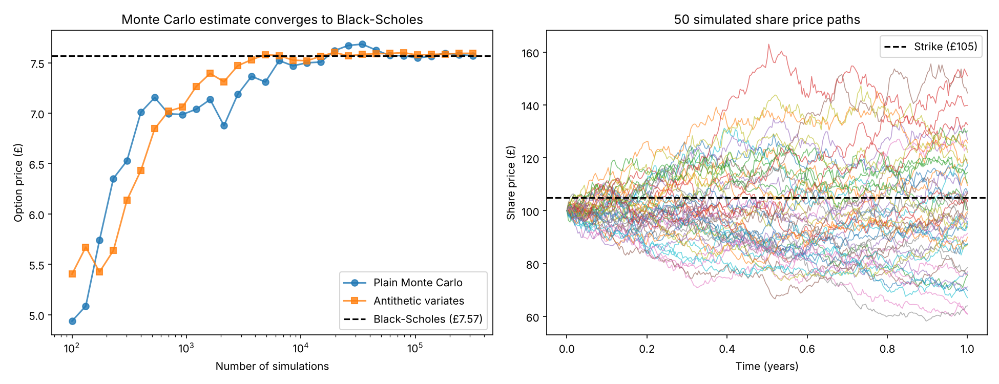

# Monte Carlo Option Pricer

A Python project that prices options by simulating thousands of possible future share prices, and checks the results against the Black-Scholes formula.



## What it does

- Simulates share prices using **geometric Brownian motion**, the standard model behind Black-Scholes
- Prices a **European call option** with Monte Carlo and compares it with the exact **Black-Scholes** price
- Uses **antithetic variates**, a variance-reduction technique, which cut the standard error by about 19% for the same number of simulations
- Shows how the estimate **converges** to the true price as the number of simulations grows

## Results (S0 = £100, K = £105, T = 1 year, r = 4%, σ = 20%)

| Method | Price | Standard error |
|---|---|---|
| Black-Scholes (exact) | £7.567 | — |
| Monte Carlo, 100,000 simulations | £7.556 | 0.041 |
| Monte Carlo + antithetic variates | £7.584 | 0.033 |

## How to run

```bash
pip install numpy scipy matplotlib
python monte_carlo_options.py
```

## Roadmap

- [ ] Price path-dependent options (Asian, barrier) that have no simple closed-form formula
- [ ] Add control variates for further variance reduction
- [ ] Estimate the Greeks (delta, vega) by simulation
- [ ] Portfolio Value-at-Risk using real FTSE 100 data, with backtesting
